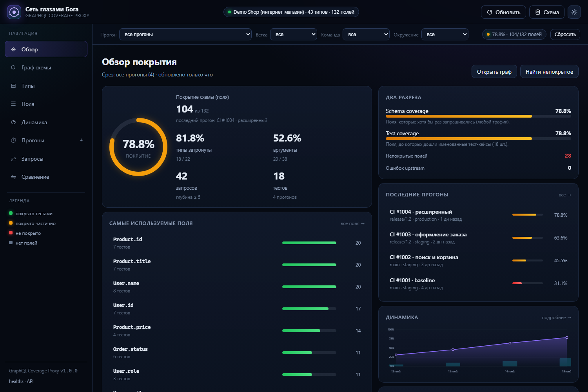
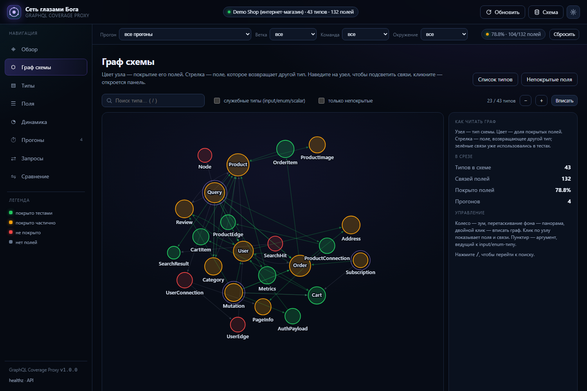
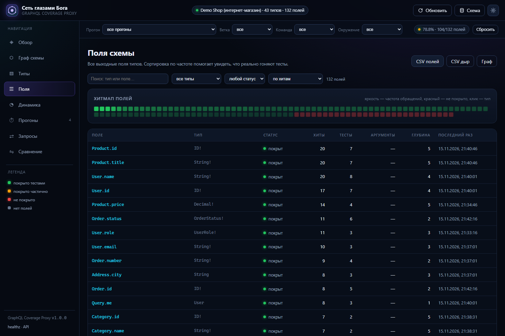
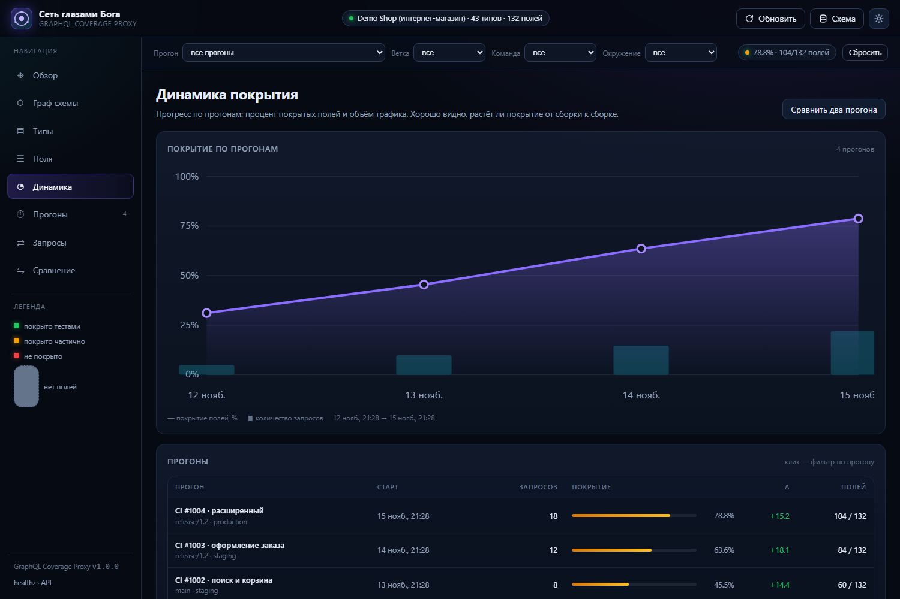
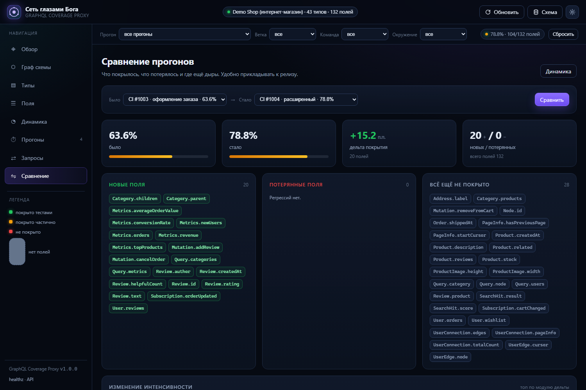
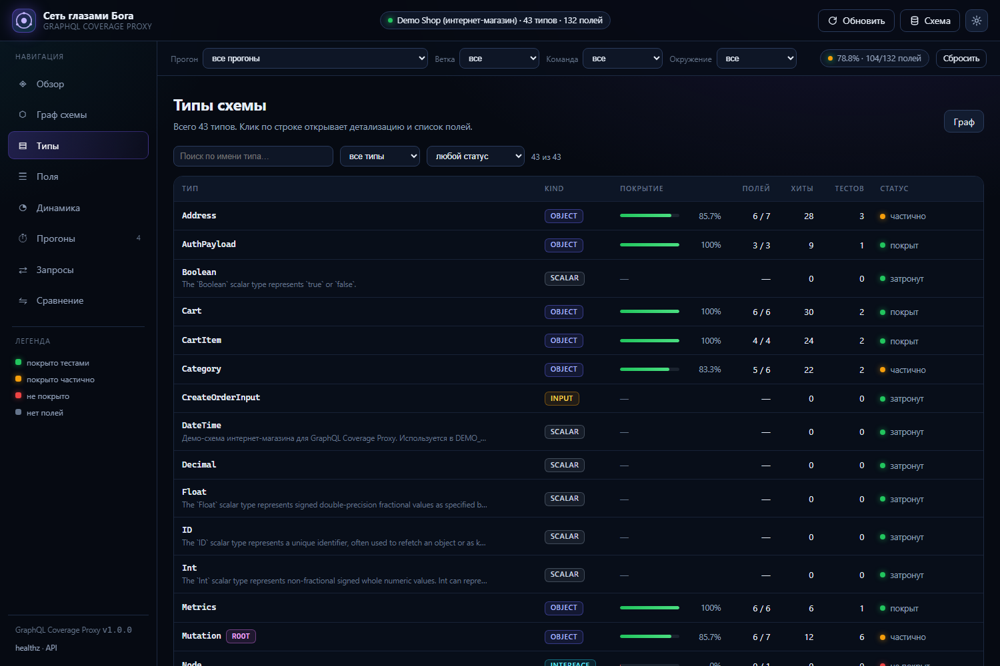

# Сеть глазами Бога — GraphQL Coverage Proxy

Сервис-прокси между автотестами и GraphQL API: перехватывает запросы, разбирает их по схеме,
считает покрытие типов, полей и аргументов и показывает это на интерактивном графе схемы.

> Рабочее название проекта — **GraphQL Coverage Proxy**. Второе имя — «Сеть глазами Бога»:
> видно всю схему сразу и сразу понятно, что реально тестируется, а что нет.



## Зачем это нужно

Юнит- и e2e-тесты гоняют GraphQL-запросы, но никто не знает, какие поля схемы они реально
задевают. Покрытие кода есть, покрытия схемы — нет. Сервис встаёт между тестами и API,
не меняя код тестов, и отвечает на вопросы:

- какие типы и поля схемы вообще использовались;
- какие поля не затронуты ни одним тестом;
- какие аргументы и input-поля проверены;
- как меняется покрытие от прогона к прогону и от ветки к ветке;
- какой именно запрос (и какой тест) стоит за конкретным полем.

## Возможности

- **Прозрачный GraphQL-прокси** `POST /proxy` (и алиас `/graphql`): запрос уходит на целевой
  endpoint, ответ возвращается клиенту без изменений, а покрытие обновляется на лету.
- **Схема из introspection или SDL**: загрузка через UI/API, хранение снапшотов, переключение.
- **Полный разбор запросов**: queries, mutations, subscriptions, алиасы, именованные и inline
  fragments, переменные, литеральные input-объекты, директивы, вложенность.
- **Две метрики**: *schema coverage* (что вообще задето трафиком) и *test coverage*
  (что задето именованными тест-кейсами).
- **История прогонов**: ветка, команда, окружение, build, commit, тест; timeline и сравнение
  before/after.
- **UI в духе GraphQL Voyager**: граф типов и связей с цветовой индикацией покрытия,
  детализация типов, хитмап полей, журнал запросов с drill-down до исходного query.
- **Экспорт** JSON/CSV, SVG-бейдж для CI, загрузка покрытия из CI без прокси (`/api/ingest`).
- **Готов к Render**: `render.yaml`, Dockerfile, health-check, graceful shutdown, GitHub Actions.

## Как это работает

```
Тесты / CI                         GraphQL Coverage Proxy                     GraphQL API
   │                                        │                                      │
   │  POST /proxy {query, variables}        │                                      │
   ├───────────────────────────────────────►│                                      │
   │   x-run-id / x-branch / x-test-id      │  1. выбрать снапшот схемы             │
   │                                        │  2. распарсить AST                   │
   │                                        │  3. сверить со схемой (validate)      │
   │                                        │  4. обновить покрытие прогона         │
   │                                        ├─────────────────────────────────────►│
   │                                        │◄─────────────────────────────────────┤
   │◄───────────────────────────────────────┤  ответ 1:1 (status, headers, body)    │
```

Данные складываются в `DATA_DIR`:

- `schemas/<id>.json` — снапшот схемы (SDL + граф типов);
- `runs/<id>.json` — прогон (ветка, команда, окружение, build, счётчики);
- `coverage/<runId>.json` — агрегированное покрытие прогона;
- `executions/<YYYY-MM-DD>.jsonl` — append-only журнал запросов.

## Быстрый старт

```bash
npm install
DEMO_MODE=true npm start
# → http://localhost:3000
```

`DEMO_MODE=true` на пустом хранилище загружает демо-схему магазина (43 типа, 132 поля) и
4 кумулятивных прогона с покрытием 31% → 46% → 64% → 79%. Так интерфейс сразу можно
посмотреть в деле.

Без демо-режима:

```bash
cp .env.example .env
# укажите TARGET_GRAPHQL_URL и/или загрузите SDL из UI (кнопка «Схема»)
npm start
```

Требования: Node.js **20.11+** (рекомендуется 22). Внешних сервисов и нативных модулей нет.

## Подключение тестов

В тестах достаточно заменить базовый URL GraphQL на адрес прокси — код запросов менять не нужно.

```bash
GRAPHQL_URL=http://localhost:3000/proxy
```

Опционально — контекст прогона в заголовках (все заголовки необязательны):

| Заголовок | Назначение | Пример |
|---|---|---|
| `x-run-id` | идентификатор прогона | `ci-1042` |
| `x-branch` | ветка | `main` |
| `x-team` | команда | `qa` |
| `x-environment` | окружение | `staging` |
| `x-build-id` | номер сборки | `1042` |
| `x-commit` | SHA коммита | `a1b2c3d` |
| `x-test-id` / `x-test-name` | тест-кейс (имя можно в percent-encoding) | `checkout/create` |
| `x-proxy-key` | ключ доступа, если задан `PROXY_API_KEY` | `secret` |

Пример на curl:

```bash
curl -s http://localhost:3000/proxy \
  -H 'content-type: application/json' \
  -H 'x-run-id: ci-1042' \
  -H 'x-branch: main' \
  -H 'x-team: qa' \
  -H 'x-environment: staging' \
  -H 'x-test-id: catalog/list' \
  -d '{"query":"query Products { products(first: 5) { edges { node { id title price } } } }"}'
```

Пример для axios:

```js
import axios from 'axios';

export const gql = axios.create({
  baseURL: process.env.GRAPHQL_URL ?? 'http://localhost:3000/proxy',
  headers: {
    'x-run-id': process.env.CI_PIPELINE_ID ?? 'local',
    'x-branch': process.env.CI_COMMIT_REF_NAME ?? 'local',
    'x-team': 'qa',
    'x-environment': process.env.CI_ENVIRONMENT ?? 'staging',
  },
});
```

Если `x-run-id` не передан, прокси создаёт авто-прогон (`AUTO_RUN_MODE=daily|session|off`),
чтобы покрытие всё равно собиралось.

## Экраны

| Обзор | Граф схемы |
|---|---|
|  |  |

| Поля и хитмап | Динамика |
|---|---|
|  |  |

| Сравнение прогонов | Типы |
|---|---|
|  |  |

- **Обзор** — сводка, два разреза (schema/test), топ полей, дыры, последние прогоны.
- **Граф схемы** — force-layout как в Voyager: зелёные/жёлтые/красные узлы, подсветка связей,
  поиск, зум, панель типа, фильтр «только непокрытые», переключатель служебных типов.
- **Типы / Тип** — покрытие по типам, поля, аргументы, входящие/исходящие связи.
- **Поля** — таблица + хитмап, сортировка по частоте, экспорт CSV.
- **Динамика** — график покрытия по прогонам, дельты.
- **Прогоны** — фильтры по ветке/команде/окружению/датам, действия по прогону.
- **Запросы** — журнал с drill-down: query, variables, затронутые поля, ошибки, ответ.
- **Сравнение** — новые/потерянные/непокрытые поля между двумя прогонами.

## API

Полное описание — [docs/API.md](docs/API.md). Кратко:

| Метод и путь | Что делает |
|---|---|
| `POST /proxy` | GraphQL-прокси со сбором покрытия |
| `POST /api/schema/introspect` | загрузить схему через introspection |
| `POST /api/schema/sdl` | загрузить SDL |
| `GET /api/coverage` | покрытие (фильтры: run, branch, team, env, from, to) |
| `GET /api/coverage/type/:name` | детализация типа |
| `GET /api/coverage/timeline` | динамика по прогонам |
| `GET /api/coverage/compare?base=&head=` | сравнение прогонов |
| `GET /api/coverage/export?format=csv&what=fields` | экспорт CSV/JSON |
| `GET /api/coverage/badge` | SVG-бейдж для CI |
| `GET /api/runs` / `POST /api/runs` | прогоны |
| `GET /api/executions` | журнал запросов |
| `POST /api/ingest` | покрытие из CI без прокси |
| `GET /api/state/export` | бэкап состояния |

## Деплой на Render через GitHub

1. Создайте пустой репозиторий на GitHub и запушьте код:

   ```bash
   git remote add origin git@github.com:<owner>/<repo>.git
   git push -u origin main
   ```

2. В Render: **New → Blueprint**, выберите репозиторий. Render прочитает `render.yaml`
   и создаст web-сервис с health-check `/healthz`.
3. Заполните `TARGET_GRAPHQL_URL` (или оставьте пустым и загрузите SDL из UI).
4. Скопируйте сгенерированный `ADMIN_TOKEN` из Render → Environment и вставьте его
   в UI (иконка шестерёнки → Admin token), чтобы загружать схемы.

Подробнее: [docs/DEPLOY.md](docs/DEPLOY.md).

> **Данные на free-плане Render эфемерны**: `/tmp` очищается при рестарте. Для продакшена
> подключите persistent disk и `DATA_DIR=/var/data` (блок в `render.yaml`).

## Конфигурация

Все переменные описаны в [.env.example](.env.example). Ключевые:

| Переменная | По умолчанию | Назначение |
|---|---|---|
| `PORT` | `3000` | порт (Render задаёт сам) |
| `DATA_DIR` | `./data` | хранилище снапшотов, прогонов, покрытия |
| `TARGET_GRAPHQL_URL` | — | целевой GraphQL-сервер |
| `SERVICES_JSON` | — | несколько сервисов: `{"shop":{"url":"..."}}` |
| `PROXY_API_KEY` | — | ключ доступа к прокси |
| `ADMIN_TOKEN` | — | ключ для изменяющих API и UI-загрузки схем |
| `ALLOW_TARGET_OVERRIDE` | `false` | разрешить `x-target-url` от клиента |
| `ALLOWED_TARGET_HOSTS` | — | allowlist хостов (SSRF-защита) |
| `ALLOW_PRIVATE_TARGETS` | `true` локально / `false` в prod | запросы к localhost/приватным сетям |
| `PROXY_STRICT_VALIDATION` | `false` | не пропускать невалидные по схеме запросы |
| `DEMO_MODE` | `false` | демо-схема и демо-прогоны |
| `AUTO_INTROSPECT` | `true` | забрать схему при старте, если её нет |
| `AUTO_RUN_MODE` | `daily` | как группировать запросы без `x-run-id` |
| `RETENTION_DAYS` | `30` | сколько дней хранить журнал исполнений |

## Структура проекта

```
src/
  server.js              точка входа, bootstrap, graceful shutdown
  app.js                 Express: CORS, healthz, прокси, API, SPA
  config.js              конфигурация из env
  proxy/                 прокси-слой и SSRF-защита
  schema/                introspection, SDL, граф схемы, кэш Schema
  analyzer/              парсинг AST, сопоставление со схемой
  coverage/              агрегация, представление, diff, CSV/SVG
  storage/               атомарное JSON-хранилище и репозиторий
  api/                   REST API для UI и CI
  demo/                  демо-данные
public/                  SPA без сборки: граф на canvas, экраны, стили
examples/                демо-схема GraphQL
test/                    unit + интеграционные тесты (node:test)
docs/                    архитектура, API, деплой, матрица требований
backend/                 исходный монолитный прототип (не используется, см. ниже)
```

### Исходный прототип

В `backend/` лежит первоначальный вариант сервиса — FastAPI-монолит `backend.py` (722 строки)
и `frontend.html` (35 КБ, React + Babel с CDN). Аудит показал, что он не покрывает
обязательные пункты концепции (загрузка SDL/introspection, аргументы, операции,
вложенность, окружения и даты, разрезы покрытия) и не готов к деплою:
подробный разбор — [docs/PROTOTYPE_AUDIT.md](docs/PROTOTYPE_AUDIT.md).

Прототип сохранён как история решения и не участвует в сборке/деплое.
Production-версия в `src/` + `public/` закрывает эти пробелы и покрыта тестами.

## Тесты

```bash
npm test          # node --test test/
npm run smoke     # сквозной smoke: демо + моковый GraphQL + прокси
```

52 теста: анализатор, схема/introspection, агрегация покрытия, хранилище, прокси
(включая SSRF, стриминг, ошибки upstream) и REST API.

## Ограничения

- **WebSocket-подписки не проксируются**: subscriptions учитываются в анализе, а HTTP/SSE-потоки
  пробрасываются как есть. Для WS нужен отдельный gateway.
- **Batch-запросы** (массив операций в одном теле) прокси отклоняет с 400.
- Хранилище **in-process**: один инстанс = один DATA_DIR. Горизонтальное масштабирование
  требует внешней БД (см. `docs/ARCHITECTURE.md`).
- Журнал исполнений — JSONL за день; поиск по нему ограничен `EXECUTION_LOOKBACK_DAYS`.
- Схема в UI — одна активная; несколько сервисов поддерживаются конфигом и API, но
  граф показывает активный снапшот.

## Соответствие требованиям

- Матрица «требование → реализация → как проверить»: [docs/REQUIREMENTS.md](docs/REQUIREMENTS.md).
- Аудит исходного прототипа и миграция вызовов: [docs/PROTOTYPE_AUDIT.md](docs/PROTOTYPE_AUDIT.md).

## Лицензия

[MIT](LICENSE)
